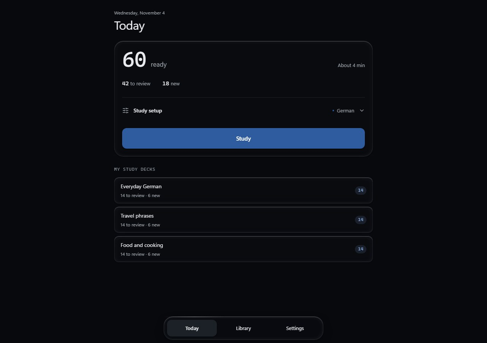
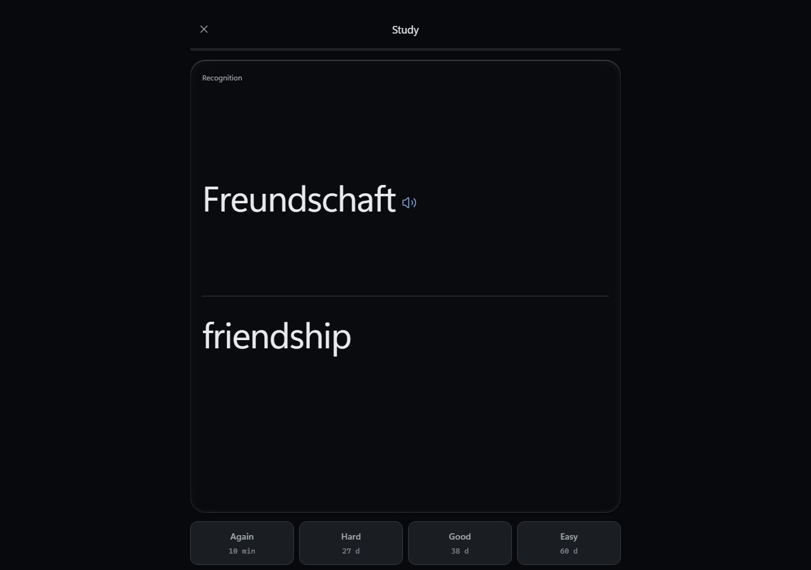
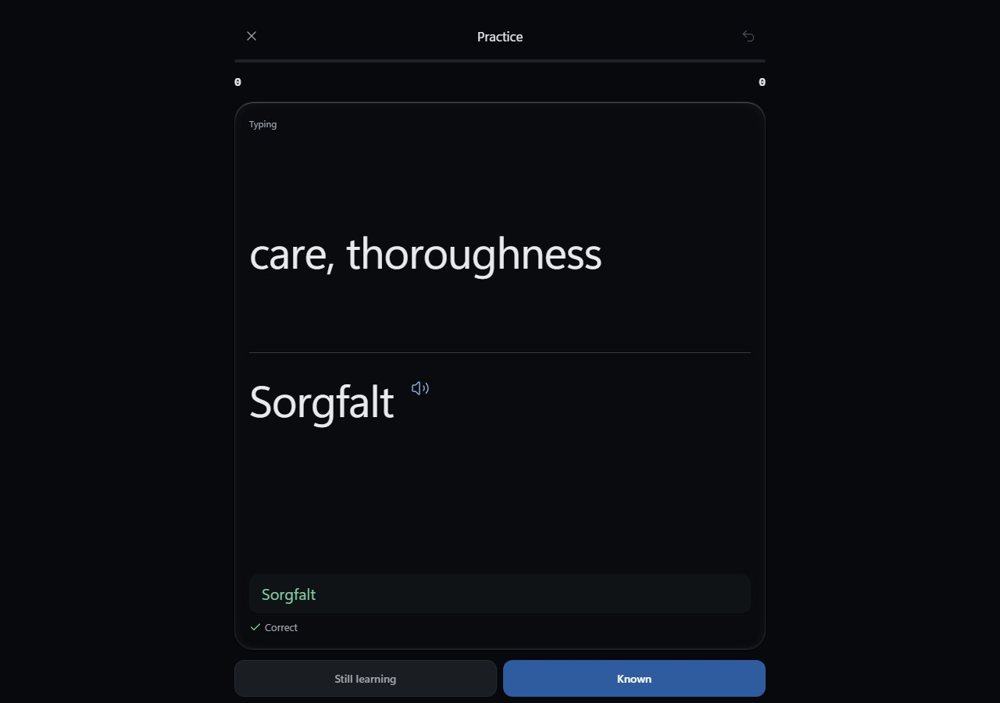

# Neuron

Spaced repetition for learning languages and remembering anything else, with a study plan that fits the time you have today.

[Open Neuron](https://neuron-web-parkour-clan.vercel.app) (account required). Working MVP in small-group testing, with offline study and synchronization implemented.

<table>
  <tr>
    <th>Daily plan on desktop</th>
    <th>iPhone view</th>
  </tr>
  <tr>
    <td width="68%"></td>
    <td width="32%"></td>
  </tr>
</table>

| Review session                                                                             | Typing practice                                                             |
| ------------------------------------------------------------------------------------------ | --------------------------------------------------------------------------- |
|  |  |

Playwright captures of the local app with synthetic demo data and iPhone emulation. All use maximum Liquid glass: Full, Panels and cards.

## Why

Anki's scheduling is useful, but I find its interface utilitarian and its workflow centered on the desktop. Its official iPhone app is a [paid companion to the computer version](https://apps.apple.com/us/app/ankimobile-flashcards/id373493387). Quizlet makes phone study approachable, though its [spaced repetition is currently website-only](https://help.quizlet.com/hc/en-us/articles/48324742264077-Studying-with-Spaced-Repetition). I wanted that simplicity with FSRS scheduling, clearer daily progress, and a plan based on available minutes.

A year-long simulation of one learner and 5,000 cards produced a longest day of **49 minutes** with a fixed limit of 50 new cards/day, versus **28 minutes** with a budget of 15 minutes on weekdays and 30 on weekends. These are rounded model results, not user data. **Neuron does not promise to teach faster.** The goal is manageable work.

Reproduce scenario S2 with `pnpm --filter @neuron/core simulate`. See the [model and its limitations](docs/algorithm.md#what-the-simulator-measured).

## Features

- Daily Study with Recognition, Recall, Typing and Listening, time estimates and Undo.
- Schedule-free Practice with self-check, typing or listening, configurable fields and saved progress.
- Offline browsing, Study and Practice after a complete download. Save note edits and new notes, folders and decks, then synchronize when connected.
- Vocabulary, Q&A and Cloze notes. Import JSON, CSV/TSV, plain text or Anki text exports with preview, duplicate handling, resume and Undo.
- Folders, collection-wide search, tags/sources, duplicate inspection and recoverable deletion. Triage imported notes as Known, Unsure or New and study them in visible waves.
- Email/password accounts, recovery codes and optional TOTP 2FA. Installable PWA, light/dark themes and adjustable Liquid glass.

Limits: import application, moves and deletion require a connection. New folders/decks must synchronize before holding content. Deck sharing, a dedicated progress dashboard and offline import application are planned.

## How it works

FSRS-6 schedules each card direction independently. The workload layer estimates answer time, forecasts future reviews and admits new cards when they fit the time budget. See the [algorithm](docs/algorithm.md).

Review history is append-only, including Undo events; deterministic replay rebuilds schedules. IndexedDB stores downloaded data and pending work, and a service worker caches the app. Reconnection delivers stable operations and pulls revisioned changes, with server-authoritative reconciliation. See [architecture](docs/architecture.md), [offline collection](docs/offline-collection.md) and [offline Study](docs/offline-study.md).

## Architecture

```text
apps/
  web/       React interface and PWA
  api/       Hono API, authentication and synchronization
packages/
  core/      Deterministic FSRS, workload policy and simulation
  shared/    Zod schemas, note/card planning and translations
  config/    Shared tooling and design tokens
```

TypeScript, React 19, Vite, TanStack Query/Router, Radix UI, Hono, Drizzle, Neon Postgres and Better Auth. Tooling: pnpm, Turborepo, Vitest and Playwright. See the [code map](docs/map.md) and [design system](docs/design-system.md).

## Status and roadmap

Recent changes still need acceptance on an installed iPhone. Next:

- Verify the integrated release on the phone, including reconnection and recovery.
- Order learning waves by imported rank.
- Unlock additional directions from demonstrated stability.
- Add a problem-card workspace.
- Add personal plans and progress/workload views.

See [current state](docs/STATE.md) and the [roadmap](docs/ROADMAP.md).

## Running locally and tests

Use Node 24 (CI version; minimum 22.13) and pnpm 11 (repository pin: 11.20.0).

```sh
pnpm install --frozen-lockfile
pnpm build
pnpm test
```

The suite contains **1,297 tests across four packages**: core, shared, web and API. PostgreSQL/RLS tests need a separate disposable `DATABASE_URL_TEST`; otherwise they are skipped. See [database setup](docs/architecture.md#running-the-database).

For the app, copy [.env.example](.env.example) to `.env`, configure your own development database and authentication settings, then:

```sh
pnpm db:migrate
pnpm db:role
pnpm db:seed
pnpm dev
```

Open [localhost:5173](http://localhost:5173). Checks: `pnpm typecheck`, `pnpm lint`, and `pnpm --filter @neuron/web test:screens:ci` for built-app interactions. See the [browser test guide](apps/web/tests/README.md).

## License

MIT. See [LICENSE](LICENSE).
