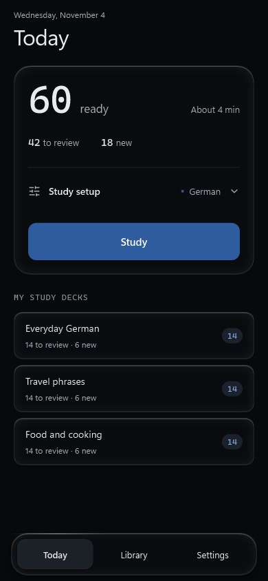
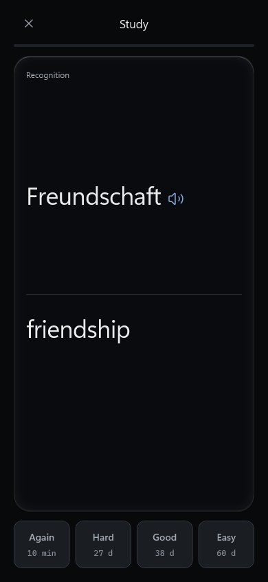
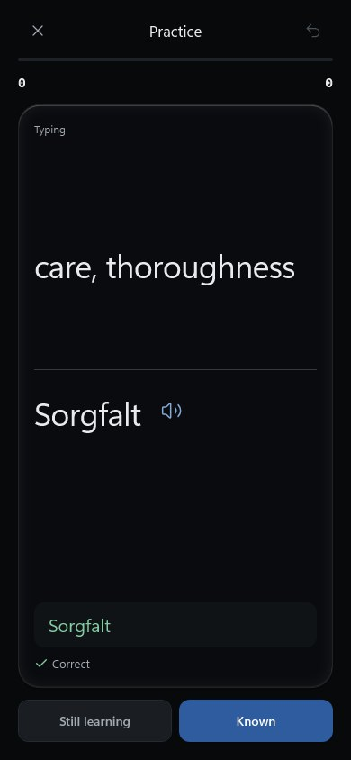
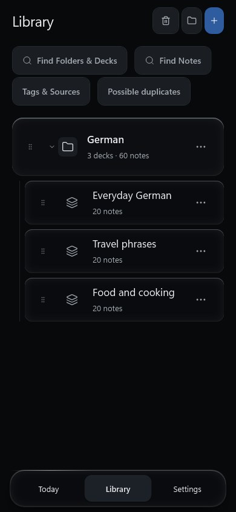
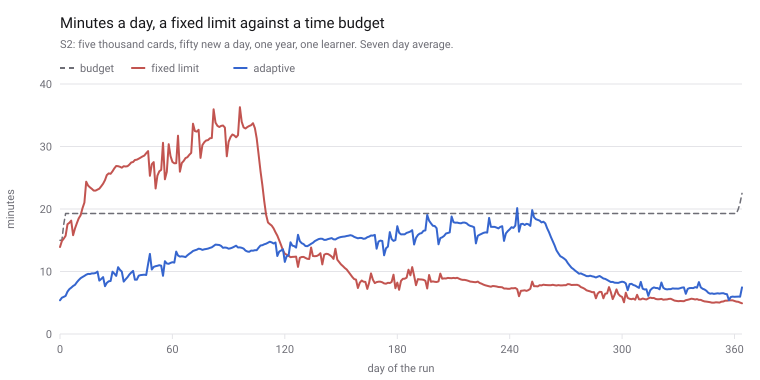

<p align="center">
  
</p>

<h1 align="center">Neuron</h1>

<p align="center">
  Spaced repetition for languages and anything you want to remember.<br>
  A study plan that fits the time you have today.
</p>

<p align="center">
  <a href="https://neuron-learn.vercel.app"><strong>Open Neuron</strong></a>
  &nbsp; · &nbsp; <a href="#features">Features</a>
  &nbsp; · &nbsp; <a href="#how-it-works">How it works</a>
  &nbsp; · &nbsp; <a href="#running-locally-and-tests">Run locally</a>
</p>

<p align="center">
  <sub>Working MVP in small-group testing. Offline Study and sync are implemented. Account required.</sub>
</p>

<br>

<p align="center">
  <a href="docs/images/today-mobile.jpg"></a>
  <a href="docs/images/study-mobile.jpg"></a>
  <a href="docs/images/practice-mobile.jpg"></a>
  <a href="docs/images/library-mobile.jpg"></a>
</p>

<p align="center">
  <sub>Daily plan &nbsp; · &nbsp; Review &nbsp; · &nbsp; Typing practice &nbsp; · &nbsp; Library</sub><br>
  <sub>Playwright, iPhone emulation, synthetic demo data. Maximum Liquid glass: Full, Panels and cards.</sub>
</p>

## Why

Anki's scheduling is useful, but I find its interface utilitarian and its workflow centered on the desktop. Its official iPhone app is a [paid companion to the computer version](https://apps.apple.com/us/app/ankimobile-flashcards/id373493387). Quizlet makes phone study approachable, though its [spaced repetition is currently website-only](https://help.quizlet.com/hc/en-us/articles/48324742264077-Studying-with-Spaced-Repetition). I wanted that simplicity with FSRS scheduling, clearer daily progress, and a plan based on available minutes.

The same learner, 5,000 cards and one simulated year. Only the admission policy changes: a fixed limit of 50 new cards/day versus a time budget of 15 minutes on weekdays and 30 on weekends.



| Simulation S2                                        | Fixed limit | Time budget |
| ---------------------------------------------------- | ----------: | ----------: |
| Heaviest day                                         |  **49 min** |  **28 min** |
| Cards retained at year end, by the model's threshold |       4,834 |       4,824 |

The graph shows seven-day averages; the peaks above use daily totals, rounded to minutes. These are model results, not user data. **Neuron does not promise to teach faster.** The goal is manageable work.

Reproduce scenario S2 with `pnpm --filter @neuron/core simulate`. See the [model and its limitations](docs/algorithm.md#what-the-simulator-measured).

## Features

|                     | What you can do                                                                                                                                                                                         |
| ------------------- | ------------------------------------------------------------------------------------------------------------------------------------------------------------------------------------------------------- |
| **Daily Study**     | Recognition, Recall, Typing and Listening, with time estimates and Undo. For vocabulary, Recall and Typing open once the direction before them is stable.                                               |
| **Practice**        | Self-check, typing or listening without changing schedules. Choose fields and resume saved progress.                                                                                                    |
| **Offline**         | Browse, study and practice after a complete download. Save note edits and new notes, folders and decks, then sync when connected.                                                                       |
| **Your collection** | Vocabulary, Q&A and Cloze notes. Import JSON, CSV/TSV, plain text or Anki text exports with preview, duplicate handling, resume and Undo.                                                               |
| **Large decks**     | Folders, search, tags/sources, duplicate inspection and recoverable deletion. Triage notes as Known, Unsure or New and study them in visible waves. Slipping cards lists the cards you keep forgetting. |
| **Account and app** | Email/password accounts, recovery codes, optional TOTP 2FA, data export, an installable PWA, light/dark themes and adjustable Liquid glass.                                                             |

Limits: import application, moves and deletion require a connection. New folders/decks must synchronize before holding content. Deck sharing, a dedicated progress dashboard and offline import application are planned.

## How it works

FSRS-6 schedules each card direction independently. The workload layer estimates answer time, forecasts future reviews and admits new cards when they fit the time budget. See the [algorithm](docs/algorithm.md).

Review history is append-only, including Undo events; deterministic replay rebuilds schedules. IndexedDB stores downloaded data and pending work, and a service worker caches the app. Reconnection delivers stable operations and pulls revisioned changes, with server-authoritative reconciliation. See [architecture](docs/architecture.md), [offline collection](docs/offline-collection.md) and [offline Study](docs/offline-study.md).

## Architecture

```text
apps/
  web/       React interface and PWA
  api/       Hono API, authentication and synchronization
packages/
  core/      Deterministic FSRS, workload policy and simulation
  shared/    Zod schemas, note/card planning and translations
  config/    Shared tooling and design tokens
```

TypeScript, React 19, Vite, TanStack Query/Router, Radix UI, Hono, Drizzle, Neon Postgres and Better Auth. Tooling: pnpm, Turborepo, Vitest and Playwright. See the [code map](docs/map.md) and [design system](docs/design-system.md).

## Status and roadmap

Recent changes still need acceptance on an installed iPhone. Next:

- Verify the integrated release on the phone, including reconnection and recovery.
- Order learning waves by imported rank.
- Add personal plans and progress/workload views.

See [current state](docs/STATE.md) and the [roadmap](docs/ROADMAP.md).

## Running locally and tests

Use Node 24 (CI version; minimum 22.13) and pnpm 11 (repository pin: 11.20.0).

```sh
pnpm install --frozen-lockfile
pnpm build
pnpm test
```

The suite contains **1,297 tests across four packages**: core, shared, web and API. PostgreSQL/RLS tests need a separate disposable `DATABASE_URL_TEST`; otherwise they are skipped. See [database setup](docs/architecture.md#running-the-database).

For the app, copy [.env.example](.env.example) to `.env`, configure your own development database and authentication settings, then:

```sh
pnpm db:migrate
pnpm db:role
pnpm db:seed
pnpm dev
```

Open [localhost:5173](http://localhost:5173). Checks: `pnpm typecheck`, `pnpm lint`, and `pnpm --filter @neuron/web test:screens:ci` for built-app interactions. See the [browser test guide](apps/web/tests/README.md).

## License

MIT. See [LICENSE](LICENSE).
